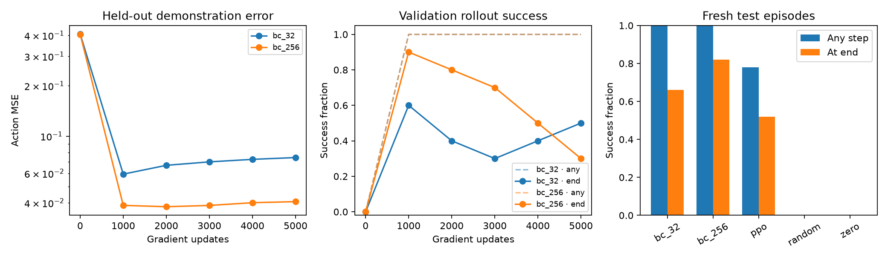

# Week 4 report: demonstrations versus reinforcement learning

Measured October 21, 2026 on Apple M3 Pro, native CPU physics. The task,
35-dimensional privileged state, eight joint-delta/gripper actions, 50-step
horizon, reward and success definition match the Week-3 PushCube experiment.

## Result on fresh test seeds

All five policies used the same **50 new reset seeds, 20000–20049**, and ran
complete episodes. Neither the previous Week-3 test seeds nor these final test
outcomes were used to choose the BC checkpoints.

| Policy | Reached goal at any step | Successful at final step | Mean return ± sample SD |
|---|---:|---:|---:|
| BC · 32 demonstrations | 50/50 (100%) | 33/50 (66%) | 34.079 ± 11.578 |
| **BC · 256 demonstrations** | **50/50 (100%)** | **41/50 (82%)** | **37.097 ± 8.713** |
| Unchanged Week-3 PPO | 39/50 (78%) | 26/50 (52%) | 23.869 ± 10.472 |
| Random actions | 0/50 | 0/50 | 2.827 ± 1.196 |
| Zero actions | 0/50 | 0/50 | 3.926 ± 0.586 |

For the larger clone, the episode-sampling 95% Wilson interval is **92.9%–100%**
for reaching at any step and **69.2%–90.2%** for final success. One model was trained
per condition; these intervals do not measure training-seed variability.

The eight additional final successes with 256 demonstrations are an observed
result in this run, not proof that performance always increases with data. On
paired test seeds, the larger clone succeeded where the smaller failed 12 times;
the reverse occurred four times. Both policies still have failures.

## Data and protocol

The pinned official ManiSkill archive includes RL-generated expert trajectories.
The first 512 joint-delta trajectories were replayed from their saved initial
states using actual actions in CPU physics. **392 replayed successfully (76.6%)**,
yielding **9,353 state/action pairs**. The other 120 were discarded by the upstream
replay tool's success filter. This retention rate exposes a CPU/GPU transfer
limitation and selects a subset of demonstrated starting conditions.

The original source observations are absent, so observations were generated by
CPU replay. Training uses observation t with action t, excluding the unmatched
terminal observation. **30.15% of recorded action scalars exceeded [-1,1]**; labels
were clipped to match the controller's effective commands. Per-feature observation
normalization uses training data only.

A deterministic episode-ID split reserved 64 demonstration episodes (1,503 pairs)
for action-error validation. The smaller training set contains 32 episodes / 773
pairs; the larger contains 256 episodes / 6,085 pairs, including the smaller set.
No trajectory or initial-observation duplicate crosses those partitions.

Both networks used the same 35→256→256→8 architecture, seed 42, Adam at 3e-4,
batches of 256 and 5,000 gradient updates. Validation rollouts used only seeds
30000–30009. Checkpoints were ranked by validation success at any step, then
final success, then lower held-out demonstration MSE. **Both selected checkpoints
came from update 1,000**, and were reloaded before final testing. Optimizer plus
periodic validation took 56.7 s for 32 demos and 50.0 s for 256 demos; expert data
collection and CPU replay are excluded from these times.

This comparison is task/protocol matched, **not compute matched**. BC receives an
external expert's demonstrations, whose original training cost is unknown here.
It is not evidence that BC universally beats PPO. The PPO checkpoint is unchanged;
its 78% reaching estimate on these 50 seeds differs from the previous 85% on 20
other seeds, as expected when measuring different episode samples.

## What failed, and what the losses explain

The larger clone reached the goal in every test episode but left the xy goal
radius in nine episodes. None of those nine failed only the cube-height criterion.
The smaller clone had 14 xy-only failures, one height-only failure and two that
violated both criteria. PPO had 22 xy-only failures, one height-only and one both.
These are classifications from measured final cube positions, not inferred
root causes.

The larger clone's training action MSE fell from 0.02615 at update 1,000 to 0.01000
at update 5,000. Over the same checkpoints, validation-rollout final success fell
from 9/10 to 3/10. The smaller clone's training MSE also fell while held-out
demonstration error increased. The selected update-1,000 checkpoints avoided
using those later models for the reported test scores.

An action predictor can fit demonstrated states closely while visiting different
states during its own rollout. Covariate shift and compounding error are possible
explanations; these aggregate measurements alone do not establish a single causal
mechanism. Demonstration noise, limited state coverage and missing post-success
holding behavior are other hypotheses worth controlled tests. Inspect the real
rollouts before claiming any particular cause.

## Inspect the evidence

[Open the visual comparison](evidence/week4_bc/index.html). It includes native
simulator videos of **the first three test seeds for both BC-256 and PPO**.
Those include a BC failure and PPO failures; they are not selected only for
successful motion. Checkpoint replay reproduced the original returns and final
success flags exactly for those six videos.

Committed evidence includes all 250 per-episode outcomes and final positions,
aggregate metrics, loss/validation curves, dataset/split provenance, versions,
checkpoint hashes and videos. Full trajectories and policy weights remain in
ignored `learning/runs/pushcube_bc_comparison/`. The training implementation was
committed as `61728c7` before the training run.

## Stage-1 flagship selection

**PickCube-v1 with the Panda arm** is the next flagship task. PushCube remains
the fast regression/reference task. PickCube adds grasp contact, gripper timing
and lifting, which create richer manipulation failures while retaining the same
simulator and reusable learning/evaluation infrastructure.

The Stage-1 sequence will be: establish state-based BC and PPO on PickCube, then
add vision or a controlled distribution shift. Preserve complete episode metrics,
repeat training with multiple seeds, and perform an ablation before claiming the
Stage-1 gate. This report completes the first Week-4 BC comparison artifact;
understanding the methods and demonstrating robust results remain separate gates.
