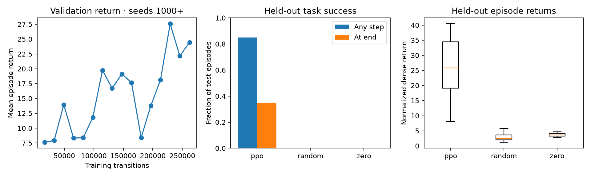

# First ManiSkill PPO run

Measured on October 21, 2026, Apple M3 Pro / macOS 26.5.2, Python 3.11.15.
Task: the unchanged ManiSkill `PushCube-v1`, state observations, joint-delta PD
actions and normalized dense reward. Full versions and hyperparameters are in
[config.json](evidence/first_run/config.json).

PPO trained for **262,144 transitions** in **191.3 seconds** (training plus
periodic validation, excluding startup and final evaluation). Four independent
CPU environments, one training seed (42). The final checkpoint was selected by
the fixed transition budget. No test-based checkpoint selection was used.

| Policy | Success at any step | Success at final step | Mean return ± sample SD |
|---|---:|---:|---:|
| PPO, deterministic evaluation | **17/20 (85%)** | **7/20 (35%)** | 25.646 ± 10.346 |
| Random actions | 0/20 | 0/20 | 2.915 ± 1.433 |
| Zero joint increments / neutral gripper | 0/20 | 0/20 | 3.673 ± 0.595 |

Every policy used the same 20 test reset seeds, **10000–10019**, and ran all 50
steps. Validation used a separate five-seed set, 1000–1004. The 95% Wilson
interval for PPO success at any step is **64.0%–94.8%**. This is uncertainty over
sampled episodes, not over different training seeds; only one model was trained.

## What worked and what did not

The learned policy substantially outperformed both simple baselines on this
small evaluation. Ten episodes succeeded temporarily but failed at the final step: nine ended
outside the goal radius, and one remained inside in xy but lifted the cube above
the allowed table height. Three episodes never succeeded. The 85% headline therefore does not establish reliable final
placement. Higher shaped reward alone is not a sufficient success criterion.

Validation performance was non-monotonic, with temporary regressions between
checkpoints. This run establishes a working train/checkpoint/evaluate pipeline
and an initial learned behavior. It does not establish multi-seed robustness,
vision competence, sim-to-real transfer or the full Stage-1 competency gate.

## Inspect the actual rollouts

Open [the visual report](evidence/first_run/index.html) through a local web server,
or open its individual videos. These are native simulator renders, not a
scripted motion or an illustrative reconstruction.

- [Seed 10000](evidence/first_run/ppo_seed10000.mp4): reached during the episode; outside the xy goal radius at the end.
- [Seed 10001](evidence/first_run/ppo_seed10001.mp4): ended within the xy goal radius, but cube height 0.0293 m exceeded the 0.025 m threshold.
- [Seed 10002](evidence/first_run/ppo_seed10002.mp4): reached and finished inside.
- [Zero-action baseline, seed 10000](evidence/first_run/zero_seed10000.mp4).

The three PPO videos use the **first three test seeds**, without selecting only
successes. Replaying the saved policy produced exactly the original returns and
success flags for these seeds. All 60 per-episode results are committed alongside
the plot, validation data, settings and checkpoint SHA-256. Full measured traces,
TensorBoard data and the checkpoint remain in ignored
`learning/runs/pushcube_ppo_seed42/` in this worktree.

## Implementation findings

The installed Mac nightly initializes Vulkan even when rendering is requested
off; a locally unpacked, checksum-verified MoltenVK driver resolved startup.
ManiSkill's optional per-step episode metrics also conflict with SB3 Monitor's
terminal-only metadata. Disabling those optional metrics and explicitly
aggregating evaluation success fixed interoperability without changing the task.
Both findings are covered by the setup instructions and simulator contract tests.

Next, follow the guide's Week-4 imitation-learning baseline on the same task,
while retaining this PPO reference. If improving PPO first, use validation to
choose a controlled change and reserve a fresh test seed set for the comparison.
