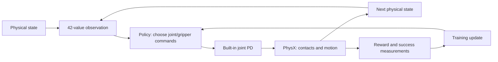

# Stage 1: explain the learning loop, not just run it

This worksheet connects the roadmap's MDP/POMDP, behavior-cloning and PPO
concepts to our PickCube experiments. It is study material, not a declaration
that the oral gate has been passed. The executable arithmetic example is
[`learning/advantages.py`](../learning/advantages.py); production training still
uses Stable-Baselines3 PPO.

## Describe the actual decision problem

An MDP describes states, actions, transition dynamics, rewards, an initial-state
distribution and a discount factor. A policy chooses actions; it does not replace
the physical transition function. In our task:

| Concept | Concrete meaning here |
|---|---|
| Physical state | Robot/cube poses and velocities, contact/physical variables, controller state and goal |
| Observation | 42 privileged values: robot positions/velocities, grasp flag, tool/cube pose, goal and relative displacements |
| Action | Seven normalized joint-position increments plus a gripper position command |
| Transition | Built-in PD and five 100 Hz PhysX steps for each 20 Hz policy action |
| Reward | Upstream reaching/grasping/placement/stillness shaping, normalized by five |
| Success metric | Cube–goal distance ≤2.5 cm in 3D **and** all seven arm speeds ≤0.2 rad/s |
| Reset distribution | Randomized cube pose, goal position/height and robot noise |
| Evaluation cap | 50 control steps; success is checked at every step and at the end |

“State-based” does not automatically mean fully observed. These 42 values omit,
for example, explicit cube linear/angular velocity and some contact/controller
information. A full simulator state can be Markov while this compact observation
is only an approximation to it. A POMDP makes the observation process explicit:
the policy receives an observation or history rather than the complete state.
Vision introduces further ambiguity and occlusion; our native videos do not
make the current policy a visual policy.



ROS is outside this tight training loop. It is useful for deployed software
communication, but we do not add ROS latency to the learning benchmark.

## Return, value and advantage answer different questions

The discounted return is a sum of future rewards,

\[
G_t=\sum_{k=0}^{\infty}\gamma^k r_{t+k}.
\]

The critic estimates expected discounted return under the policy, typically
from the available observation. An advantage estimates how much better or worse
a sampled action was than that baseline. A positive advantage is evidence to
increase that sampled action's probability; it does not mean “increase the
motor command” or “the task succeeded.”

Our raw episode-return metric sums the 50 observed task rewards without
discounting. PPO's critic/advantages use gamma=0.99. These are related quantities
with different purposes. A grasp-and-lift policy can receive considerable dense
return while never meeting the complete placement/stillness predicate, as our
PPO results demonstrated. Return is not a success percentage.

For one transition, a bootstrapped temporal-difference error is

\[
\delta_t=r_t+\gamma(1-\mathrm{terminated}_t)V(o_{t+1})-V(o_t).
\]

Generalized advantage estimation combines these errors backward:

\[
A_t=\delta_t+\gamma\lambda\,c_t A_{t+1},
\qquad c_t=1-\mathbb{1}[\mathrm{terminated}_t\lor\mathrm{truncated}_t].
\]

This form handles packed episodes when each supplied next-value estimate belongs
to the actual transition's final observation. Both kinds of boundary stop the
trace from absorbing rewards from the next reset episode. Only true termination
removes the next-state bootstrap. The target used to fit the value function is
`advantage + current_value`; it can differ from a pure sampled return when
lambda is below one.

Lambda=0 gives a one-step TD estimate. Lambda=1 accumulates errors through the
available trajectory; at a genuine terminal ending, consistent next-state values
cancel to recover discounted sampled returns minus the current value estimate.
Smaller lambda reduces reliance on distant sampled outcomes but depends more on
the critic's estimates. It does not universally improve a robot policy.

## Worked three-step example

These are invented rewards/value predictions for arithmetic, not measured robot
rollouts. Set gamma=0.9 and lambda=0.8. The last transition is an external time
limit, with predicted value 0.8 at its actual final observation.

| Step | Reward | Current V | Next V | TD error | GAE advantage | Value target |
|---|---:|---:|---:|---:|---:|---:|
| 0 | 1 | 0.5 | 0.4 | 0.86 | 2.209568 | 2.709568 |
| 1 | 1 | 0.4 | 0.2 | 0.78 | 1.874400 | 2.274400 |
| 2, time limit | 1 | 0.2 | 0.8 | 1.52 | 1.520000 | 1.720000 |

For example, `delta[2] = 1 + 0.9*0.8 - 0.2 = 1.52`, then
`advantage[1] = 0.78 + 0.9*0.8*1.52 = 1.8744`.

If the last transition were a **true terminal ending**, its next-state value
would be zero for bootstrapping regardless of the critic's supplied 0.8.
The final target becomes 1.0; earlier targets become 1.756 and 2.33632.
Changing the mask changes learning targets even though the observed rewards are
identical. Run both cases:

```bash
.venv/bin/python -m learning.advantages
.venv/bin/python -m pytest -q tests/learning/test_advantages.py
```

The root MuJoCo venv is sufficient; this example needs no simulator or Torch.
Tests check analytic lambda/gamma limits, the hand calculation, and absence of
reward leakage across both kinds of reset boundary.

## Avoid the auto-reset trap

At a time limit, a vector environment may return the *next episode's reset
observation* as its main observation. The value bootstrap must use the previous
episode's final observation, not the reset state. SB3/Gym wrappers preserve that
final observation separately. Normalization must also be applied consistently
to that terminal observation. A normalization integration test should compare it
with the raw simulator transition and confirm that task reward units remain intact.

A time limit inherent to a finite-horizon MDP is different from an external
sampling cap: it can be true termination, and remaining time must be represented
when needed for the Markov property. The worksheet follows the explicit flags
provided by an environment; it does not decide that every clock limit should
bootstrap. Our benchmark's ignore-success/full-horizon wrapper and SB3's
truncation handling must be inspected rather than inferred from a plot.

## What PPO's losses mean

PPO stores observations, sampled actions, old action log-probabilities and value
predictions, then computes advantages and repeatedly updates on that rollout.
The policy ratio is

\[
\rho_t=\frac{\pi_{\mathrm{new}}(a_t\mid o_t)}{\pi_{\mathrm{old}}(a_t\mid o_t)}.
\]

Its clipped policy objective uses

\[
\min\!\left(\rho_t A_t,\,
\operatorname{clip}(\rho_t,1-\epsilon,1+\epsilon)A_t\right).
\]

The optimizer minimizes the negative of that objective along with a weighted
value-prediction loss and any entropy term. The exact implementation also uses
minibatches, normalized advantages and other details. The clipping discourages
some excessive probability-ratio changes; it is not an absolute guarantee that
policy KL stays below a fixed threshold.

| Logged quantity | What it helps inspect | What it does not establish |
|---|---|---|
| Policy loss | Surrogate optimization on sampled actions | Actual task success or a universal cross-run ranking |
| Value loss | Fit to bootstrapped value targets | Correct actions or well-calibrated physical predictions |
| Approximate KL | Size of policy-distribution changes | That a smaller change solves the task |
| Clip fraction | Fraction of sampled ratios beyond the clipping range | A target that should always be minimized |
| Entropy / action std | How broad the action distribution is | Deliberate exploration of useful grasps |
| Explained variance | How much target variation the critic explains | Proof that policy optimization is correct |

Our LR ablation reduced mean approximate KL from 0.05655 to 0.02042 while both
PPO forks still had zero complete test successes. Smaller optimizer steps did
not produce slower physical joint motion. That is why the physical metrics and
native rollouts remain essential.

## What cloning teaches about distribution shift

BC fits actions on demonstration observations. During deployment, its own small
mistakes alter future states, which can move it away from the demonstration
state distribution. Low held-out action MSE therefore need not imply successful
closed-loop behavior. A one-step error in gripper timing can cause a dropped
cube that changes many subsequent observations.

Our small clone's training MSE improved while held-out MSE worsened. The larger
clone also had nearly equal offline losses at checkpoints with different rollout
success. These are different symptoms: overfitting the data and instability in
closed-loop behavior. The observation-fault exercise is a third cause: correct
weights receiving an incorrect goal. Restoring the goal recovered all clean
records without any optimizer update.

Input normalization changes feature scaling, not physical units or the task.
It must be fit on training observations and frozen for evaluation. Using test
observations to update those statistics would leak test information. Statistics
and model parameters also form a matched checkpoint; loading one without the
other can change actions even with identical network weights.

## Rehearse without notes

1. Trace one joint/gripper command through PD, physics, reward and the next observation.
2. Explain why our “state” observation is not proof of complete observability.
3. Distinguish episode return, critic value, advantage and success rate.
4. Recalculate the final target for true termination versus a time limit.
5. Explain why a reset observation is the wrong bootstrap state.
6. Explain what positive and negative advantages do to action probabilities.
7. Explain how lower KL can coexist with zero robot-task success.
8. Diagnose training MSE improving while rollout performance gets worse.
9. Separate a bad observation contract from an optimizer or physics failure.
10. State what is saved and frozen when evaluating a normalized policy.

Primary references: [GAE paper](https://arxiv.org/abs/1506.02438),
[PPO paper](https://arxiv.org/abs/1707.06347),
[Gymnasium termination/time-limit guidance](https://gymnasium.farama.org/tutorials/gymnasium_basics/handling_time_limits/),
[SB3 PPO implementation/API](https://stable-baselines3.readthedocs.io/en/master/modules/ppo.html).
Our numerical experiment results are in
[the PickCube report](../learning/maniskill/PICKCUBE_RESULTS.md) and
[the continuation/fault report](../learning/maniskill/PPO_DEBUG_RESULTS.md).
