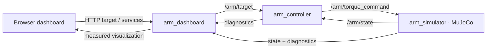

# ROS arm systems lab

This connects the two-link arm's existing kinematics and MuJoCo physics through
three separate ROS 2 processes. The browser draws measured ROS state and sends
commands through a dashboard node. The controller does not step the simulator.

## Start and stop

From this branch's repository root, with Docker Desktop running:

```bash
docker compose -p foundations-arm -f ros2_ws/arm.compose.yaml up -d --build
```

Open **http://localhost:8766**. The first launch builds custom ROS messages;
wait for the three nodes to show Connected. Docker publishes the dashboard only
on Mac localhost. The standalone arm viewer on port 8765 remains a separate lab.

```bash
# Read startup output or stop this lab
docker compose -p foundations-arm -f ros2_ws/arm.compose.yaml logs --tail 40
docker compose -p foundations-arm -f ros2_ws/arm.compose.yaml down
```

The source checkout is mounted into Ubuntu 24.04/Jazzy. Editing Python source
requires restarting the arm service; browser assets update on refresh. Generated
build outputs, logs and bags stay under this checkout's ignored `ros2_ws/` folders.
This experiment fixes link lengths at 1 m and 0.75 m, gravity in the arm's plane,
and motor limits at ±20 N·m.

## Try the visualization

1. Watch the measured arm converge to the target. Solid links are physical state;
   the dashed arm is the joint reference. Plan view accepts target clicks;
   3D view supports orbiting. The target marker reflects controller diagnostics.
2. Press **Other target**, then **Kick elbow +2**. Compare hand error, applied
   torque and recovery. Pause freezes integration while ROS observations continue.
   Reset restores 30°/60° at rest, preserves pause state, and starts a new epoch.
3. Set command delay to **50 ms**, Apply, then move the target. Observe the latency
   rise. At **200 ms**, commands exceed the **150 ms** freshness limit: stale
   counts increase, the watchdog applies zero motor torque, and gravity still
   moves the arm. Restore **0 ms**, Apply, then Reset to recover.
4. **Record bag**, make a target change or kick, wait a few seconds, then **Stop
   recording**. **Replay last bag** switches to recorded observations. Live controls
   are disabled in that view; live simulation continues independently. Switch to
   **Live ROS** to resume interaction. Stop replay is available during playback.

The error and torque charts retain the most recent 600 dashboard observations.
HTTP polling is about 10 Hz; this is separate from the ROS stream rate. It can
miss intermediate motion even though the recording contains the full stream.

## Trace the loop



| Interface | Type | Meaning |
|---|---|---|
| `/arm/state` | `arm_interfaces/ArmState` | Measured q, qvel, applied torque, simulation time, reset epoch and sequence |
| `/arm/joint_states` | `sensor_msgs/JointState` | Standard shoulder/elbow measurements |
| `/arm/torque_command` | `arm_interfaces/ArmCommand` | Raw requested torque, joint reference, originating observation stamp/sequence/epoch |
| `/arm/target` | `geometry_msgs/PointStamped` | Hand target in the world frame, metres |
| `/arm/reset`, `/arm/kick` | `std_srvs/Trigger` | Reset state or add +2 rad/s elbow velocity |
| `/arm/pause` | `std_srvs/SetBool` | Pause/resume physical integration |
| `/arm_controller/set_parameters` | `rcl_interfaces/SetParameters` | Set `command_delay_ms` from 0 to 300 |
| `/arm/simulator_status`, `/arm/controller_status` | `diagnostic_msgs/DiagnosticArray` | Targets, freshness, delay, rejected commands and watchdog state |

Physics advances in five 2 ms steps per nominal 10 ms timer tick (500 Hz physics,
100 Hz observations and torque updates). The controller updates its DLS hand
velocity command every 20 ms of simulation time, integrates a bounded joint
reference, and applies PD gains 80/12 plus model-based bias compensation. Motor
limits clamp the resulting physical torque. While paused, messages still flow
and torque commands may change, but the simulator does not integrate them.

Timers and DDS on Docker Desktop are **not hard real time**. Simulation advances
a fixed amount per callback and may run slower than wall time under load. Message
headers use ROS system time; `sim_time` records MuJoCo's independent clock. State
and command correlation stays explicit across transport and resets.

## Read the measurements

- **Measured state** rate comes from dashboard receive times over a rolling
  two-second window. Freshness is elapsed monotonic time since a received message.
- In live view, **State → command arrival** measures original observation stamp
  to command receipt at the dashboard. It includes controller processing, injected
  delay and DDS delivery; it is an observer measurement, not a physics deadline.
- Simulator diagnostics independently measure receipt latency at the actuator
  process. Replay displays these **recorded simulator** latencies. It does not
  subtract an old bag timestamp from today's clock and call that network delay.
- Original message age is shown separately. It grows after playback finishes;
  receive freshness also grows when no new messages arrive. Both are expected.
- The simulator rejects wrong epochs, repeated/out-of-order observation sequences,
  stale command/observation stamps and malformed vectors. A reset clears accepted
  commands; delayed commands from the previous reset cannot drive the new state.
- ROS links use reliable, volatile, depth-one queues to favor recent samples.
  Reliable delivery does not make old commands safe; the application freshness
  checks and watchdog provide that rule.

## Record, replay and inspect

Bags include state, standard joint states, commands, targets and both diagnostic
topics under `ros2_ws/evidence/arm_<UTC>/bag`. Stop recording before exiting so
SQLite metadata is finalized. Restarting the dashboard forgets its last-bag UI
selection, but the files remain available through the ROS CLI.

Replay remaps **every recorded topic** into `/replay/arm/*`. The bag player has
no publisher on the live torque topic. This allows inspection without sending
historical commands back to a running physical loop.

```bash
docker compose -p foundations-arm -f ros2_ws/arm.compose.yaml exec arm bash
# Inside Ubuntu:
source /opt/ros/jazzy/setup.bash
source install/setup.bash
ros2 node list
ros2 topic info /arm/torque_command --verbose
ros2 topic echo /arm/joint_states --once
ros2 service call /arm/reset std_srvs/srv/Trigger '{}'
# ros2 bag info evidence/arm_<UTC>/bag
```

## Validation and files

```bash
# Separate test container/domain; leaves the live dashboard running.
docker compose -p foundations-arm -f ros2_ws/arm.compose.yaml run --rm \
  -e ROS_DOMAIN_ID=44 arm bash -c \
  'source /opt/ros/jazzy/setup.bash && source install/setup.bash && python3 -m pytest -v src/arm_bridge/test'
```

Build the live service first to create the workspace install overlay. CI performs
that build in a fresh container before testing. Seven ROS tests cover protocol
validation, distinct processes and real convergence, target/service behavior,
pause/reset/kick recovery, delay and watchdog behavior, invalid input rejection,
and every recorded state message replaying unchanged through DDS. Replay compares
canonical CDR serialization to remove irrelevant uninitialized padding bytes.
The original math/MuJoCo and browser-helper suites run separately.

- `src/arm_interfaces/`: custom stamped messages and ROS interface build.
- `src/arm_bridge/arm_bridge/`: independent controller, simulator and HTTP/ROS bridge.
- `web/arm_ros.html`, `web/arm_ros.js`: browser visualization and controls.
- `scripts/arm_system.py`, `scripts/start_arm.sh`: process lifecycle and workspace build.
- `Dockerfile.arm`, `arm.compose.yaml`: Jazzy/MuJoCo environment, domain 43.

ROS references: [QoS concepts](https://github.com/ros2/ros2_documentation/blob/jazzy/source/Concepts/Intermediate/About-Quality-of-Service-Settings.rst),
[rosbag2](https://github.com/ros2/rosbag2), and
[rclpy executors](https://docs.ros.org/en/jazzy/p/rclpy/rclpy.executors.html).
