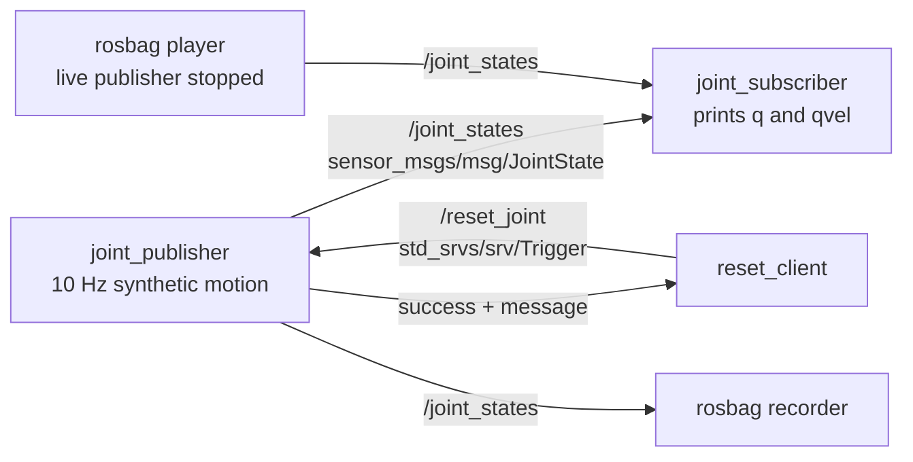

# stage0_basics

This is the Week 1 middleware exercise. The joint state has the same meaning
as MuJoCo's qpos/qvel: angle in radians and angular rate in radians/second.
Here it comes from a sine function, so you can inspect message flow without
running the physics viewer.



The publisher generates `q = 0.5 sin(pi*t)` and
`qvel = 0.5*pi*cos(pi*t)` at 10 Hz, stamps each message, and names the joint
`hinge`. The reset service restarts the sine's phase at zero; it does not reset
the ROS clock. Both topic endpoints use reliable, volatile, keep-last-10 QoS.

## Open Ubuntu terminals

First follow [workspace setup](../../README.md). In each Mac terminal, from
the repository root, enter the same running container:

```bash
docker compose -f ros2_ws/compose.yaml exec ros2 bash
```

Then source both environments in each Ubuntu terminal:

```bash
source /opt/ros/jazzy/setup.bash
source install/setup.bash
```

The commands below all run inside Ubuntu. Ctrl+C stops a node and leaves the
Ubuntu shell open.

## 1. Check standard talker/listener

Terminal A:

```bash
ros2 run demo_nodes_cpp talker
```

Terminal B:

```bash
ros2 run demo_nodes_cpp listener
```

You should see `Publishing` in A and `I heard` in B. Stop both before moving on.

## 2. Run your own publisher and subscriber

Terminal A:

```bash
ros2 run stage0_basics joint_publisher
```

Terminal B:

```bash
ros2 run stage0_basics joint_subscriber
```

B prints `sample=... q=... rad qvel=... rad/s` about ten times per second.
The angle ranges from -0.5 to +0.5 rad, completing a cycle every two seconds.
The publisher is normally quiet; a quiet terminal does not mean it has failed.

## 3. Inspect and reset

Terminal C:

```bash
ros2 node list
ros2 node info /joint_publisher
ros2 topic list -t
ros2 topic info /joint_states --verbose
ros2 topic echo /joint_states --once
ros2 service list -t
ros2 service type /reset_joint
ros2 interface show std_srvs/srv/Trigger
ros2 run stage0_basics reset_client
ros2 service call /reset_joint std_srvs/srv/Trigger '{}'
```

Find `/joint_publisher` and `/joint_subscriber`, and the topic type
`sensor_msgs/msg/JointState`. Topic info shows endpoint counts and QoS.
Echo shows the timestamp, `hinge`, position and velocity fields. The service
has an empty request and a response with `success` and `message`. Either
client should report success; watch the angle restart near zero in B.

## 4. Record and replay

Keep A and B running. In C:

```bash
mkdir -p bags
ros2 bag record --storage sqlite3 -o bags/first_joint --topics /joint_states
```

Wait about five seconds, then press Ctrl+C in C to finish the bag cleanly.
Each recording needs a new output directory name. Inspect it:

```bash
ros2 bag info bags/first_joint
```

It should contain `/joint_states` with a nonzero message count. Now **stop the
publisher in A** with Ctrl+C. B should stop printing. In C:

```bash
ros2 bag play bags/first_joint --delay 1
```

B should print again for the duration of the recording, then stop. Its data
now comes from the bag player. The original message timestamps are preserved;
replay does not run physics or regenerate the sine wave.

## What the concepts mean here

| Concept | Concrete example |
|---|---|
| Node | `joint_publisher` or `joint_subscriber`, each with callbacks and ROS interfaces |
| Topic | `/joint_states`, a stream sent to matching subscribers |
| Service | `/reset_joint`, a short request with a success response |
| Action | A future long-running goal with feedback, cancellation and result; not implemented here |
| Bag | Saved topic messages that another process can publish again |

ROS carries the data between components. Our callback generates the motion;
in a future integration a simulator or encoder would provide the joint state,
and a controller would read it to compute motor commands.

## Debugging

- `Package not found`: build the package and source `install/setup.bash`.
- Nodes cannot see each other: use this same container for every terminal;
  check `printenv ROS_DOMAIN_ID ROS_AUTOMATIC_DISCOVERY_RANGE` matches.
- Echo is silent: check the publisher is running and inspect
  `ros2 topic info /joint_states --verbose` for type and QoS compatibility.
- Reset fails: start `joint_publisher`; our client fails after a bounded wait.
- Replay appears mixed with live motion: stop `joint_publisher` first.
- After a ROS domain/environment change: `ros2 daemon stop`, then retry
  graph inspection in the correctly sourced shell.

## Official references

- [Python publisher/subscriber](https://docs.ros.org/en/jazzy/Tutorials/Beginner-Client-Libraries/Writing-A-Simple-Py-Publisher-And-Subscriber.html)
- [Python service/client](https://docs.ros.org/en/jazzy/Tutorials/Beginner-Client-Libraries/Writing-A-Simple-Py-Service-And-Client.html)
- [Recording and replaying data](https://docs.ros.org/en/jazzy/Tutorials/Beginner-CLI-Tools/Recording-And-Playing-Back-Data/Recording-And-Playing-Back-Data.html)
